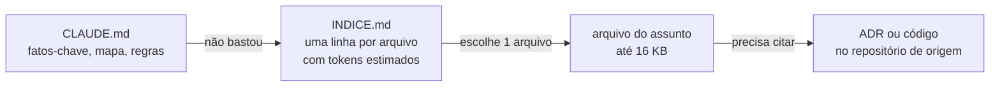

# claude-works

[](https://github.com/cleberSan/claude-works/actions/workflows/ci.yml)
[](https://github.com/cleberSan/claude-works/actions/workflows/codeql.yml)
[](LICENSE)

Base de conhecimento do meu ecossistema de desenvolvimento, escrita para o **Claude** ler antes de trabalhar: projetos, decisões, convenções, stacks, APIs, trechos de código, modelos, pipelines, skills e fluxos de agentes. O objetivo é que cada conversa ou sessão comece sabendo o essencial **sem reler históricos nem repositórios inteiros**, gastando poucos tokens.

Os projetos documentados aqui:

| Projeto | O que é |
|---|---|
| [careflow](https://github.com/cleberSan/careflow) | Projeto vitrine: agenda multi-clínica, cofre de dados de pacientes, consentimento LGPD, triagem com IA e direitos do titular. .NET 10, PostgreSQL, RabbitMQ, OpenTelemetry, dados 100% sintéticos |
| [portfolio-web](https://github.com/cleberSan/portfolio-web) | Meu site pessoal ([no ar](https://portfolio-web-psi-rust.vercel.app)), com diário de bordo e o Painel do CareFlow. Next.js 16 |
| [lojinha-da-lua](https://github.com/cleberSan/lojinha-da-lua) | Catálogo de uma loja com pedido pelo WhatsApp ([no ar](https://lojinha-da-lua.clebersan.workers.dev)). Astro 7 + ilha React, Cloudflare |

## Como a leitura economiza tokens



1. **[CLAUDE.md](CLAUDE.md)** (o Claude Code carrega sozinho): quem sou, os repositórios, os checks obrigatórios, as regras que valem sempre e o mapa das pastas.
2. **[INDICE.md](INDICE.md)** (gerado): uma linha por arquivo com o resumo e o custo estimado em tokens. O Claude escolhe o que abrir.
3. **Arquivo do assunto:** fatos em listas e tabelas, com `resumo:` e `atualizado:` no topo.
4. **Fonte original** por link (ADR, código), só para citar ou conferir.

Leitura mínima (CLAUDE.md + INDICE.md) fica em torno de 6 mil tokens; a base inteira, perto de 60 mil. `npm run tokens` mostra os números atuais.

## Estrutura

| Pasta | Conteúdo |
|---|---|
| [memorias/](memorias/) | Perfil e preferências, convenções de trabalho, decisões com data, lições aprendidas, ambiente da nuvem |
| [projetos/](projetos/) | Cartão de cada projeto (estado, ADRs, rotas, testes, deploy, pendências); o CareFlow tem arquitetura, fases, convenções e operação |
| [stacks/](stacks/) | .NET, Next.js, Astro + Cloudflare, testes, segurança, observabilidade, hospedagem gratuita, IA aplicada |
| [apis/](apis/) | Padrões HTTP, catálogo de rotas e eventos do CareFlow, APIs externas |
| [snippets/](snippets/) | Código real dos projetos, recortado: Result + ProblemDetails, idempotência, RLS, Outbox/Inbox, CSP, Playwright + axe, estado no localStorage |
| [templates/](templates/) | ADR, PR, README, SECURITY, cartão de projeto, prompt e decisões de fase, post do diário, skill, subagente, checklists |
| [pipelines/](pipelines/) | Workflows prontos: CI .NET, CI Node, CodeQL, conferência diária em produção, Dependabot |
| [agents/](agents/) | Fluxos de agentes autônomos: fase nova, revisão de PR, correção de bug, conteúdo, atualização da base |
| [.claude/skills/](.claude/skills/) | Skills: `kb-atualizar`, `nova-fase`, `novo-adr`, `novo-repositorio`, `texto-linkedin`, `analise-staff`, `investigar-bug` |
| [.claude/agents/](.claude/agents/) | Subagentes: pesquisador, implementador, QA destrutivo, guardião de segurança, revisor Staff, redator, curador da base |
| [scripts/](scripts/), [utils/](utils/) | Validador, índice, custo em tokens, gerador de arquivos a partir de modelos, preparo de repositório novo, ambiente da nuvem |
| [docs/](docs/) | ADRs desta base e glossário |

## Usando com o Claude

### Claude Code (terminal, desktop ou web)

- **Trabalhando neste repositório:** o `CLAUDE.md` e as skills de `.claude/skills/` carregam sozinhos.
- **Trabalhando em outro repositório:** clone o claude-works ao lado e importe os fatos-chave no `CLAUDE.md` do outro projeto com uma linha:

  ```markdown
  @../claude-works/CLAUDE.md
  ```

- **Skills e subagentes em todos os projetos:** ligue as pastas ao seu diretório de usuário.

  ```bash
  mkdir -p ~/.claude/skills ~/.claude/agents
  ln -s "$PWD"/.claude/skills/* ~/.claude/skills/
  ln -s "$PWD"/.claude/agents/*.md ~/.claude/agents/
  ```

### Projetos no claude.ai

- No conhecimento do projeto, adicione pelo GitHub **só** o `CLAUDE.md`, o `INDICE.md` e as pastas do trabalho (ex.: `memorias/` e `projetos/careflow/`). Anexar tudo gasta o que a base quer economizar.
- Nas instruções do projeto: *"Comece pelo CLAUDE.md. Se não bastar, consulte o INDICE.md e abra só o arquivo do assunto. Confira estado volátil (PR, CI, deploy) no repositório antes de afirmar."*
- Uma skill pode ser enviada nas configurações do claude.ai como `.zip` da pasta dela (ex.: `cd .claude/skills && zip -r novo-adr.zip novo-adr`).

### Threads de projeto

Adicione o claude-works aos repositórios do projeto: toda thread nova clona a base e lê o `CLAUDE.md` antes de começar.

## Manutenção

```bash
npm run indice     # regera o INDICE.md depois de criar ou mudar um resumo
npm run validar    # front matter, índice, links, tamanho, skills e dados sensíveis
npm test           # testes dos scripts com cobertura mínima de 80%
npm run tokens     # quanto custa ler cada parte
npm run modelo -- --listar
```

Sem dependências: Node 24 (funciona a partir do 22.12), nada para instalar. Detalhes em [scripts/README.md](scripts/README.md); fluxo de contribuição em [CONTRIBUTING.md](CONTRIBUTING.md).

## O que nunca entra aqui

O repositório é público. Ficam de fora segredos e chaves, identificadores de conta de nuvem, contato pessoal ou de terceiros (o meu público é só [LinkedIn](https://www.linkedin.com/in/cleber-costa-santos/) e GitHub), CPF mesmo sintético, assuntos pessoais de carreira e dados de clientes. O validador barra os formatos mais comuns; a revisão do PR cuida do resto. Veja [SECURITY.md](SECURITY.md).

## Decisões

- [ADR-0000](docs/adr/0000-registrar-decisoes-com-adr.md): registrar decisões com ADR.
- [ADR-0001](docs/adr/0001-base-em-camadas-e-publica.md): base em camadas, pública, em português, com índice gerado e validador sem dependências.

## Licença

[MIT](LICENSE), como os outros repositórios. Vale para o texto e os scripts desta base; código copiado dos outros projetos segue a licença de lá (também MIT).
