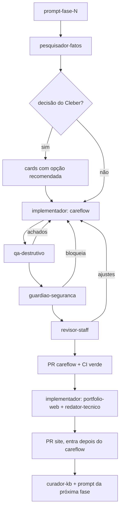

# Fluxo: fase de projeto

Entrada: `prompt-fase-N.md` colado pelo Cleber. Saída: PR no careflow, PR no portfolio-web, base atualizada, `prompt-fase-(N+1).md`. Skill equivalente: `nova-fase`.

## Passos

1. **Ler**: `CLAUDE.md`, `projetos/careflow/README.md`, `projetos/careflow/fases.md`, o ADR da fase anterior.
2. **Pesquisar** (`pesquisador-fatos`): cada ponto do prompt que depende de fato externo. Escrever `fase-N-decisoes.md` ([modelo](../templates/decisoes-fase.md)).
3. **Cards**: só o que é decisão do Cleber, com opção recomendada. Seguir na recomendada no que for reversível.
4. **Implementar** (`implementador`) no careflow em fatias: domínio e testes, endpoints, eventos, observabilidade, ADR, README.
5. **Quebrar** (`qa-destrutivo`) e **proteger** (`guardiao-seguranca`); voltar ao implementador até não haver achado bloqueante.
6. **Revisar** (`revisor-staff`); corrigir; CI verde com cobertura ≥ 80%.
7. **PR do careflow** em rascunho, Cleber como assignee.
8. **Site** (`implementador` + `redator-tecnico`): post do diário, `careflowPhases`, links para o ADR. PR do site só entra depois do careflow.
9. **Fechar** (`curador-kb`): `projetos/careflow/*`, `memorias/decisoes.md`, lições; escrever `prompt-fase-(N+1).md` ([modelo](../templates/prompt-fase.md)).

## Parada

- Card sem resposta e o próximo passo depende dele: entregar o que não depende e esperar.
- Dois ciclos sem CI verde: relatar a falha com a saída e a hipótese.
