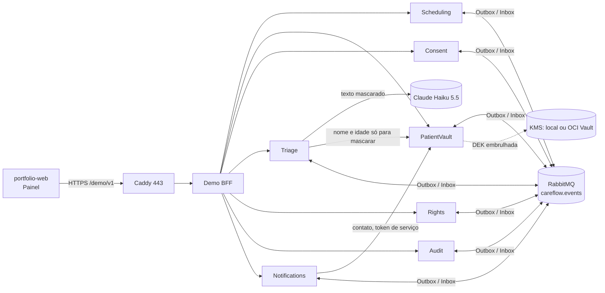

# Arquitetura do CareFlow

## Visão

Consumidores (quem reage a quê): Scheduling (`patient.registered`, `consent.granted`, `consent.revoked`), Notifications (`appointment.booked`, `appointment.cancelled`, consentimento, `rights.identity-verification-requested`), Audit (`audit.data-access`, `audit.content-disclosed`, `rights.subject-request-opened`), Triage (consentimento), Rights (respostas e `rights.identity-verification-dispatched`); todos os serviços com dado do paciente respondem a `rights.subject-request-opened`. Catálogo: [apis/careflow.md](../../apis/careflow.md).

Cada serviço tem **banco PostgreSQL próprio**, RLS por clínica e Outbox/Inbox. Só o cofre guarda dado pessoal; os demais conhecem o pseudônimo `patientRef`.

## Serviços

| Serviço | Responsabilidade | O que guarda | ADR |
|---|---|---|---|
| Scheduling | Agenda multi-clínica sem dupla reserva | Consultas, projeção `patient_statuses` (cadastro + consentimento) | 0002, 0008 |
| PatientVault | Cofre de dados pessoais | Campos cifrados, blind index do CPF, DEK por paciente embrulhada | 0004, 0012 |
| Consent | Consentimento por finalidade (`scheduling`, `notifications`, `ai-triage`) | Registro por (clínica, paciente, finalidade), base legal, versão do termo | 0008 |
| Audit | Trilha append-only | Entradas encadeadas por HMAC; trigger recusa UPDATE/DELETE/TRUNCATE | 0007 |
| Notifications | Confirmação, lembrete, cancelamento | Jobs e status por canal; **nunca** o contato | 0009 |
| Triage | Sugestão de prioridade com IA | Texto mascarado, prioridade, revisão do profissional, proteções acionadas | 0011 |
| Rights | Pedidos do titular (acesso, portabilidade, eliminação) | Pedidos, pacote cifrado por até 7 dias | 0012 |
| Demo | Backend do Painel (BFF) | Sessões, clínica sintética por visitante, registro em arquivo para limpeza | 0010, 0013 |

## Fluxos principais

- **Reserva:** `POST /v1/appointments` com `Idempotency-Key` → trava `FOR SHARE` na projeção do paciente → confere elegibilidade → insere (exclusion constraint resolve a corrida) → auditoria + `appointment.booked` no Outbox na mesma transação → Notifications envia confirmação.
- **Revogação:** Consent grava `consent.revoked` → agenda bloqueia reservas e cancela futuras com motivo `ConsentRevoked` → Notifications avisa o cancelamento → tudo auditado. Um trace só, do Consent ao aviso.
- **Paciente ainda não conhecido pela agenda:** 409 `Agenda.PacienteAindaNaoConhecido`; o cliente repete com a mesma `Idempotency-Key` (consistência eventual aceita, ADR-0008).
- **Triagem:** alarmes por regra no texto original → consentimento `ai-triage` → detector de prompt injection → mascaramento (mais de 50% mascarado não sai) → modelo com saída por JSON Schema → guard de linguagem clínica → prioridade final = max(modelo, piso dos alarmes). Qualquer desvio cai para só as regras; o profissional sempre confirma ou corrige.
- **Eliminação:** Rights abre o pedido → código de 6 dígitos ao contato (cifrado para o Notifications) → cada serviço responde → cofre destrói a DEK do paciente (crypto-shredding) → comprovante com a versão da política de retenção. Auditoria fica e continua íntegra.

## Segurança em camadas

- **Identidade:** JWT com escopos por serviço (`<serviço>.read|write|admin`, `vault.contact.read`, `triage.submit|review`) e claim `tenant_id`. Menor privilégio: quem envia triagem não lê nem revisa.
- **Isolamento por clínica:** filtro global por tenant no EF + **RLS com `FORCE`** no PostgreSQL; `app.tenant_id` gravado a cada abertura de conexão (sobrescrito, inclusive com vazio); recurso de outra clínica responde **404**. Readiness falha se o login da API for superusuário ou tiver `BYPASSRLS`.
- **Papéis no banco:** API com login sem dono (`<svc>_api`, papel `<svc>_app`), despachante (`<svc>_dispatcher`, papel `<svc>_relay`) que só vê Outbox/Inbox, migrations com `<svc>_owner` (sem superusuário, sujeito ao FORCE RLS).
- **Criptografia do cofre:** AES-256-GCM por campo com AAD `clínica|paciente|campo`; três níveis de chave: DEK do paciente → chave da clínica → chave mestra no KMS (`IKeyManagementService`; implementação local recusada em produção e no ambiente `Demo`); subchaves por HKDF; blind index HMAC do CPF; `If-Match`/ETag nas alterações.
- **Serviço a serviço:** token curto assinado com P-256 por clínica (Notifications e Triage leem o cofre); código de identidade do Rights cifrado para a chave pública do Notifications (`SealedBox`).
- **Auditoria:** cada leitura e alteração de dado de paciente, cada aviso enviado ou não, cada triagem (com SHA-256 do pedido ao modelo, nunca o texto).
- **Telemetria sem PII:** redação no serviço e no Collector, baggage externo descartado, teste E2E que varre spans, logs e métricas atrás de nome, CPF, telefone e e-mail.
- **Borda (fase 9):** só `/demo/v1/*` passa pelo Caddy; corpo até 8 KB no Caddy e 4 KB no Demo; limites por IP, por sessão e por clínica; teto de 8 clínicas simultâneas; interruptor sem redeploy.

## Mensageria (ADR-0006)

- Exchange topic `careflow.events`, routing key = tipo do evento; fila quorum `careflow.{serviço}` com `x-delivery-limit` e DLQ própria; exchange alternativo guarda em `careflow.unrouted` o que nenhuma fila recebe.
- **Outbox:** evento gravado na mesma transação (`db.Enqueue`); despachante trava lote com `FOR UPDATE SKIP LOCKED`, publica com confirmação, marca despachado; backoff exponencial com jitter; ids UUID v7 crescentes.
- **Inbox:** `inbox_messages (consumidor, message_id)` na mesma transação do efeito; duplicata descartada.
- Clínica no cabeçalho `careflow-tenant-id`, nunca no corpo; consumidor abre escopo com a clínica e o RLS vale.
- Broker fora não derruba o serviço: saúde do broker fica fora do `ready`, eventos esperam no Outbox.
- `traceparent` atravessa o broker; spans `CareFlow.Messaging`; contadores de publicados, falhas, duplicatas e rejeitados.

## Resiliência (ADR-0009)

- `Microsoft.Extensions.Http.Resilience` (Polly v8): timeout, retry com jitter, circuit breaker por canal; fallback WhatsApp → SMS → e-mail na ordem da clínica.
- Sem mensagem duplicada: chave de idempotência estável por aviso e canal, consulta de status no provedor antes de trocar de canal.
- Falhas injetáveis por canal (`Latency`, `Error`, `Unavailable`, `LostResponse`), desligadas por padrão, mudadas sem reiniciar.
- Lembretes com `notification_jobs.due_at` + `FOR UPDATE SKIP LOCKED`; sem Redis.

## Observabilidade (ADR-0010)

- OpenTelemetry nos 8 serviços: traces, métricas de negócio e logs, exportados por OTLP quando `OTEL_EXPORTER_OTLP_ENDPOINT` existe.
- Stack local no compose: Collector, Tempo, Loki, Prometheus, Grafana (imagens AGPL sem modificação), dashboards versionados (latência, Outbox, DLQ, propagação da revogação, fallbacks, circuit breaker).
- Na VM: a mesma stack enxuta, retenção de 3 dias, Grafana só por túnel SSH.

## Painel de Privacidade e Resiliência

- Cada visitante ganha uma clínica sintética nova (GUID) e uma partição de circuit breaker (slots 1 a 64); purga por serviço (`DELETE /v1/demo/clinic-data`, `Demo:PurgeEnabled`) mantém a auditoria.
- O CI grava os cenários (reserva com trace, dado em cada serviço, revogação, fallback, triagem, direitos do titular) e o site reproduz a gravação com data e commit. CPF e telefone mascarados até os 2 últimos dígitos.
- Modo ao vivo (fase 9): sessão por token opaco de 32 bytes em `Authorization: Bearer`, guardado só na memória da página; servidor guarda o hash.
